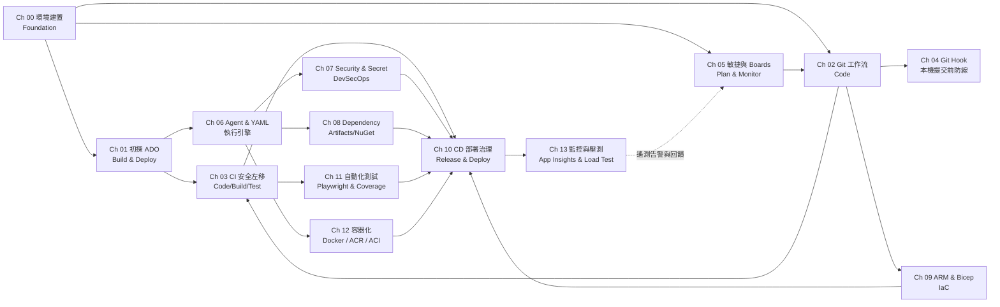

# AZ-400 Azure DevOps 實戰課程全章節分析 × Jerry 作業成果報告

> [!NOTE]
> - **課程講義來源**：恆逸（uuu）AZ-400 五日實戰班（2026/11/17, 18, 19, 24, 25，講師 David）— [HackMD 原始講義](https://hackmd.io/@twdeveloper/ByykzFuAGx)（已全面移除課堂臨時測試帳號、API Key 與 Token）。
> - **作業成果來源**：[AZ-400 挑戰賽作業紀錄表 (Google Sheet)](https://docs.google.com/spreadsheets/d/1tKMEZCayTNYGCPBlZ-LN9rafCvD0B7JHyEEZvccHNbs/edit?gid=0#gid=0) — 學員 **Jerry（台壽，職責：開發＋維運「都有」）**。
> - **互動簡報版**：建議同步開啟線上互動簡報 [`slides.html`](https://childkuo.github.io/az400LL/slides.html)（支援鍵盤翻頁、總覽格狀檢視與作業篩選表）。

---

## 一、Jerry 挑戰賽作業成果總覽

| 指標項目 | 數值 / 表現 | 說明與亮點分析 |
| :--- | :---: | :--- |
| **課堂指派 Lab 完成率** | **100%（29 / 29）** | 5 天課堂實際指派且有學員繳交的 29 項 Lab **全數達標** |
| **全班挑戰賽排名** | **並列第 1 名** | 全班 11 位學員中，9 位完成 29 題、2 位完成 28 題，Jerry 穩居頂標梯隊 |
| **總表 38 欄達成率** | **76.3%（29 / 38）** | 表單另保留 9 欄進階/延伸單元（Lab 18, 26, 27-2, 29, 31–36＋預留 37–38），全班皆為 0 筆繳交 |
| **高難度差異化攻克** | **2 / 2 全破** | 全班唯二有人缺交的關卡 **Lab 20-1（Bicep，10/11）** 與 **Lab 27-1（Playwright，10/11）**，Jerry 皆成功完成 |
| **五日實作節奏** | `4 → 4 → 7 → 5 → 9` | **Day 5 單日爆衝完成 9 項高難度 Lab**（Bicep → Classic CD → 簽核 → Gate → 藍綠 → Multi-Stage YAML → Playwright → Coverage → Docker ACR） |

### 課程 14 章節與 DevOps 生命週期地圖

---

## 二、全 14 章節深度分析（主旨・目標・知識點・注意地方・LAB 題目）

---

### Ch 00｜課前帳號準備與實戰環境建置

- **對應階段**：`Foundation`（整體前置基礎）
- **章節主旨**：統一開發者本機工具鏈、雲端帳號與沙盒實驗室（Go Deploy LMS），排除環境差異造成的實作阻礙。
- **學習目標**：
  1. 備妥 Microsoft Account（MSA），並開通 Azure Portal 與 Azure DevOps Organization。
  2. 完成免費 CI/CD 平行管線（Parallelism）額度申請與本機開發環境安裝。
  3. 熟悉 Go Deploy 虛擬實驗室啟用、延長機制與 Azure DevOps Demo Generator 範本匯入。
- **章節知識點**：
  - **雲端入口**：`portal.azure.com`、`dev.azure.com`、`aex.dev.azure.com`、免費平行作業申請（`aka.ms/azpipelines-parallelism-request`）。
  - **本機開發工具鏈**：.NET Core SDK（3.x / 5.x / 7.x / 8.x / 9.x）、Visual Studio 2022 Community、VS Code、Git、Docker Desktop（需硬體虛擬化）、Postman、Windows Terminal。
  - **VS Code 必裝套件**：`Azure Repos`、`gitignore`、`C#`、`Chinese (Traditional) Language Pack`、`GitHub Copilot`、`GitHub Copilot Chat`、`HTML Snippets`。
  - **實驗室與範本**：Go Deploy LMS（`lms.godeploy.it`）兌換與啟動；Azure DevOps Demo Generator 快速建立範例專案。
- **注意地方（避坑指南）**：
  - ⚠️ **新組織預設無免費平行管線額度**：自 2021 年起新申請的個人 Azure DevOps Org 必須填表申請 Free Parallelism（審核約 2–3 個工作天），否則無法使用 Microsoft-Hosted Agent。
  - ⚠️ **VS 2022 安裝工作負載**：務必勾選 ASP.NET 與 Web 開發、Azure 開發與容器工具，避免後續 Docker/App Insights Lab 缺元件。
  - ⚠️ **Go Deploy 實驗室倒數延長**：需於到期前 **15 分鐘內** 點選 `Extend` 按鈕才能延長時間，逾時將自動銷毀環境。
- **前置檢核題目 / 狀態**：
  - 帳號註冊、環境安裝、Lab Access 開通 — **Jerry 狀態：✅ Lab Access = 1（Day 1 順利開通）**。

---

### Ch 01｜Meet Azure DevOps（初探 Azure DevOps 與 CI/CD 最小閉環）

- **對應階段**：`Build` → `Deploy`（Go Deploy AZ-400 Lab 06）
- **章節主旨**：以最短路徑打通「匯入程式碼 → 自動建置（CI）→ 自動部署至雲端 Web App（CD）」的最小可行閉環，建立對 Azure Pipelines 的直覺體感。
- **學習目標**：
  1. 建立 Azure DevOps Team Project 並從 GitHub 匯入範例程式碼（`dotNet8BMISample`）。
  2. 使用 Classic Editor 建立 Build Pipeline 並啟用 CI Trigger。
  3. 於 Azure Portal 建立 App Service，並透過 `Azure App Service Deploy` Task 完成端到端自動部署。
- **章節知識點**：
  - **Team Project 與 Repo Import**：跨平台直接匯入外部 GitHub Repository。
  - **Classic Editor 與 CI Trigger**：圖形化組裝建置步驟並勾選 `Enable continuous integration`，達成每次 Commit 自動觸發建置。
  - **預定義系統變數**：`$(build.artifactstagingdirectory)/**/*.zip` 指定打包成品路徑，銜接建置與部署任務。
  - **Azure App Service (Web App)**：選取方案層級（F1/S1）、執行階段（ASP.NET / .NET）與區域（如 Canada Central）。
- **注意地方（避坑指南）**：
  - ⚠️ **新版 ADO 預設隱藏 Classic Editor**：若建置管線畫面找不到「Use the classic editor」，需前往 Organization / Project Settings → Pipelines → Settings 關閉「Disable creation of classic build pipelines」。
  - ⚠️ **套件路徑格式**：`Azure App Service Deploy` 預設路徑有時指向舊版資料夾，務必確認改為 `$(build.artifactstagingdirectory)/**/*.zip` 才能正確找到發佈壓縮檔。
  - ⚠️ **首次 Commit 需先設 Git 身分**：未設定 `git config --global user.name` 與 `user.email` 會導致本機提交失敗。
- **LAB 題目與 Jerry 實作成果**：
  - **Lab 1｜Create a pipeline**：建立專案 → 匯入 `dotNet8BMISample` → Classic Editor 建立管線並開啟 CI Trigger → 修改程式碼驗證自動觸發。
    - **Jerry 成果**：✅ **已完成（2026/11/17，全班 11/11）**。
  - **Lab 2｜CI & Deploy to Web App**：建立 Azure Web App → 於管線加入 `Azure App Service Deploy` Task → 設定成品路徑 → 修改程式並驗證自動部署上線。
    - **Jerry 成果**：✅ **已完成（2026/11/17，全班 11/11）**。

---

### Ch 02｜Azure Repos 與 Git 工作流（Version Control & GitHub Flow）

- **對應階段**：`Code`（雙向連動 `Plan`，Go Deploy AZ-400 Lab 02）
- **章節主旨**：建立標準化 Git 版本控制紀律，並以 **GitHub Flow + Pull Request + Work Item 連動** 取代易造成合併地獄的長壽命分支模式。
- **學習目標**：
  1. 熟練本機 Git 初始化、`.gitignore` 配置、遠端推送與重新 Clone 驗證。
  2. 實作完整的「PBI → SBI → Task → Feature Branch → PR → Reviewer Approve → Merge」協作流程。
  3. 理解 Trunk-Based / GitHub Flow 為何優於傳統 Git Flow，並掌握工作項目關聯層級設計原則。
- **章節知識點**：
  - **本機 Git 核心指令**：`git config --list`、`git init`、`git add .`、`git commit -m`、`git log`、`git remote add origin`、`git push -u origin --all`、`git clone`。
  - **`.gitignore` 治理**：在首次 `git add` 前即排除 `bin/`、`obj/`、`.vs/` 與機密組態檔。
  - **Azure Boards × Repos 雙向追蹤**：從 Task 直接建立 Feature Branch，PR 合併時自動關閉 Task 並刪除短命分支。
  - **理論基石（指定閱讀）**：Martin Fowler《Continuous Integration》、Dave Farley《Git Flow Is A Bad Idea》——強調小批次、短生命週期分支、高頻率整合主幹。
- **注意地方（避坑指南）**：
  - ⚠️ **先加 `.gitignore` 再 `git add .`**：若已不小心提交 `bin/` 或機密檔案，事後補 `.gitignore` 並不會自動移出追蹤紀錄（需 `git rm --cached`）。
  - ⚠️ **為何 Branch 要關聯 `Task` 而非 `PBI` 或 `Bug`？** 一個 PBI 通常包含前端、後端、DB 等多個 Task；若直接把 PR 關聯至 PBI，合併後勾選「Complete associated work items」會**誤把尚未全部完工的 PBI 提前標記為 Done**！關聯 Task 才能維持小批次精準追蹤。
  - ⚠️ **合併後自動刪除 Feature Branch**：避免遠端累積大量過期殭屍分支。
- **LAB 題目與 Jerry 實作成果**：
  - **Lab 3-1 & 3-2｜Local Git & Push to Azure Repo**：建立 `.NET` WebApp → 加入 `.gitignore` → Commit 並 Push 至 Azure Repos → 刪除本機資料夾後透過 `git clone` 還原驗證。
    - **Jerry 成果**：✅ **已完成（2026/11/17，全班 11/11）**。
  - **Lab 4｜GitHub Flow & PR**：建立 PBI → 移至 SBI → 展開 Task → 由 Task 建立 Feature Branch → 修改 `WebBMI/Pages/Index.cshtml` → 發起 PR 指定 Reviewer → Approve & Merge 並驗證三項結果（程式碼更新、Task 自動 Done、分支自動刪除）。
    - **Jerry 成果**：✅ **已完成（2026/11/17，全班 11/11）**。

---

### Ch 03｜CI 持續整合與品質安全左移（Continuous Integration & DevSecOps）

- **對應階段**：`Code` → `Build` → `Test`（安全與品質左移）
- **章節主旨**：將「編譯驗證、AI Code Review、靜態弱點掃描（SAST）、開源套件稽核（SCA）」全部左移至 Pull Request 階段，建立自動化品質防線，杜絕有缺陷的程式碼流入 `main` 主線。
- **學習目標**：
  1. 設計並區分 `CI Pipeline`（面向 Prod）與 `PR-CI Pipeline`（面向 Dev/Test）雙管線架構，並綁定 `main` Branch Policy。
  2. 整合 Azure OpenAI（GPT PR Reviewer）在 PR 頁面上自動進行程式碼審查留言。
  3. 整合 SonarCloud（SAST）與 WhiteSource Bolt / Mend（SCA）產出弱點、技術債與授權合規報表。
- **章節知識點**：
  - **雙管線與 Branch Policy**：`main` 分支啟用 **Build Validation** 綁定 `PR-CI`（需關閉其 CI Trigger 避免重複觸發）；PR 通過並合併後才由 `main` 觸發正式 `CI Pipeline`。
  - **AI 自動化審查（GPT PR Reviewer）**：串接 Azure OpenAI Endpoint（GPT-4o），自動分析 PR Diff 並於對應行數留下改善建議。
  - **SAST 靜態分析（SonarCloud）**：掃描 Bugs、Vulnerabilities、Security Hotspots、Code Smells 與修復工時估算（Effort）。
  - **SCA 成分分析（WhiteSource Bolt / Mend）**：偵測第三方 NuGet/npm 套件的已知 CVE 漏洞與開源授權風險（如 GPL 傳染性授權）。
- **注意地方（避坑指南）**：
  - ⚠️ **PR-CI 必須移除 CI Trigger**：複製（Clone）主 CI 建立 PR-CI 後，若忘記關閉 CI Trigger，每次 Push 都會重複跑兩條管線。
  - ⚠️ **GPT PR Reviewer 雙重權限缺一不可**：(1) **Repo 權限**：須授予 `Build Service` 帳號 `Contribute to pull requests` 權限，否則無法在 PR 留言；(2) **Pipeline 權限**：須在 Agent Job 勾選 `Allow scripts to access the OAuth token`。
  - ⚠️ **切勿將 API Key / Token 硬編碼進程式碼或公開文件**：應改用 Secret Variables 或 Azure Key Vault（銜接 Ch 07）。
- **LAB 題目與 Jerry 實作成果**：
  - **Lab 5｜PR-CI**：建立 CI 與 PR-CI 雙管線 → 設定 `main` Branch Policy（Build Validation）→ 由 Task 建分支改程式 → 發起 PR 驗證 PR-CI 觸發，合併後再驗證正式 CI 觸發。
    - **Jerry 成果**：✅ **已完成（2026/11/18，全班 11/11）**。
  - **Lab 6｜Auto Code Review with GPT in PR-CI Pipeline**：於 PR-CI 加入 GPT PR Reviewer Task、配置 Repo 與 OAuth 權限 → 故意在 `BmiCalculator.cs` 植入硬編碼密碼、除以零、精度截斷與空泛 `//todo` → 發起 PR 檢視 AI 留言。
    - **Jerry 成果**：✅ **已完成（2026/11/18，全班 11/11）** — 實證截圖顯示 `test20261118jerry` PR #828 由 `Build Service` 成功以繁體中文逐點抓出全部 4 項缺陷！
  - **Lab 7｜SonarCloud**：安裝 SonarCloud 擴充並於管線串接分析與發布 Quality Gate → 檢視雲端報告。
    - **Jerry 成果**：✅ **已完成（2026/11/18，全班 11/11）** — 實證截圖顯示 SonarQube Cloud 成功解析 PR `828 - fb1`，標示 **23 項總議題（8 項 Top Issues、1h 5m 修復工時）**，抓出 `Error.cshtml.cs` CSRF 保護關閉（High）與 `BmiCalculator.cs` 硬編碼 `"pwd"`（Medium）。
  - **Lab 8｜Package Scan**：安裝 WhiteSource Bolt v2 擴充 → 加入掃描任務並檢視套件漏洞與授權報告。
    - **Jerry 成果**：✅ **已完成（2026/11/18，全班 11/11）**。

---

### Ch 04｜Git Hook 本機提交前防線（Pre-Commit Security Gate）

- **對應階段**：`Code`（極致左移——本機端即時攔截）
- **章節主旨**：將資安與品質檢查前移至「`git commit` 發生之前」，在機密字串或敏感語句進入本機 Git 歷史紀錄前即刻阻斷，避免事後洗 Git 歷史的高昂代價。
- **學習目標**：
  1. 理解 `.git/hooks/` 的事件驅動機制（`pre-commit`、`commit-msg`、`pre-push` 等）。
  2. 撰寫 `pre-commit` Shell Script 攔截包含 `password`、`todo`、`sql` 等黑名單關鍵字的程式碼變更。
- **章節知識點**：
  - **Hook 執行原理**：當指令返回非 0 退出碼（`exit 1`）時，Git 會立即中止該次 Commit。
  - **增量檢查指令**：`git diff-index --patch HEAD | grep '^+' | grep -Pi 'password|todo|sql'` 僅掃描本次「新增的行（`+`）」，避免誤報舊程式碼。
  - **防禦縱深（Defense in Depth）**：本機 Git Hook（最快回饋）＋ 雲端 Branch Policy / PR-CI（強制執行、無法繞過）。
- **注意地方（避坑指南）**：
  - ⚠️ **`.git/hooks/` 不會隨 Git Push 同步**：Hook 位於 `.git` 內部，團隊共享需透過 `.githooks/` 搭配 `git config core.hooksPath` 或 Husky / pre-commit 框架。
  - ⚠️ **本機 Hook 可被 `--no-verify` 繞過**：因此 Git Hook 僅能作為**開發者第一道提醒防線**，不可取代雲端 CI 與密鑰掃描！
  - ⚠️ **Windows 環境 Shebang 路徑**：在 Windows Git Bash 中需確認第一行 `#!C:/Program\ Files/Git/usr/bin/sh.exe` 或 `#!/usr/bin/env sh` 與檔名「無副檔名（`pre-commit`）」。
- **LAB 題目與 Jerry 實作成果**：
  - **Lab｜使用 Git Hook 在 Commit 前進行程式碼檢查**：在 `.git/hooks/pre-commit` 建立攔截腳本 → 撰寫含 `sql` / `password` 的程式碼並嘗試 `git commit` → 驗證系統輸出黑名單錯誤訊息並成功阻擋提交。
    - **Jerry 成果**：📌 **課堂示範/延伸單元（挑戰賽表單未設獨立繳交欄，建議納為日常團隊防線）**。

---

### Ch 05｜敏捷開發與需求管理（Agile, Scrum, Boards, Dashboard & Wiki）

- **對應階段**：`Plan` ↔ `Monitor`（需求追蹤與管理透明化）
- **章節主旨**：落地敏捷宣言與 Scrum 2020 框架，運用 Azure Boards、Capacity 負載平衡、數位戰情儀表板與 Azure Wiki，打造「需求—任務—程式碼—文件」全程可追溯的透明協作體系。
- **學習目標**：
  1. 建立 Scrum Process 專案，將業務需求（HR 請假系統）拆解為標準 User Story（PBI）並排入 Sprint Iteration。
  2. 展開 Tasks、估算 Remaining Hours、配置成員 Capacity，透過 Work Details 與燃盡圖控管進度。
  3. 建立 Shared Queries、狀態圖表與全維度團隊 Dashboard，並於 Wiki 整合 Mermaid 圖表與 `#WorkItem` 雙向關聯。
- **章節知識點**：
  - **Scrum 核心框架**：參考 2020 Scrum Guide 與敏捷宣言；PBI（Product Backlog Item）→ SBI（Sprint Backlog Item）→ Task 階層結構與 Effort 估算。
  - **產能與進度可視化**：Team Capacity（每人每日可用工時）對照 Work Details 負荷條，搭配 Sprint Burndown Chart 識別範圍膨脹（Scope Creep）與落後風險。
  - **團隊效能指標**：**CFD（累積流量圖）** 觀測瓶頸與 WIP；**Cycle Time**（開工→完成，衡量工程效率）vs **Lead Time**（提案→完成，衡量客戶體感交付時間）。
  - **活文件（Living Documentation）**：Azure Wiki 支援 Markdown、Mermaid 流程/架構圖、`@人員標註`、`#工作項ID` 即時狀態連動；若需與 Notion 同步可評估 Unito 等雙向同步工具。
- **注意地方（避坑指南）**：
  - ⚠️ **Query 必須存到 `Shared Queries`**：存在 `My Queries` 的個人查詢無法新增至團隊 Dashboard，也無法供 Ch 10 Lab 23 Release Gate 呼叫！
  - ⚠️ **先設定 Iteration 起訖日期**：未在 Project Settings → Team Configuration 設定 Sprint 日期，燃盡圖與 Capacity 將無法正常顯示。
  - ⚠️ **Cycle Time / Lead Time 需要足夠完工紀錄**：新建專案若尚無完成歷程，初期圖表會顯示 0 筆結果屬正常現象。
- **LAB 題目與 Jerry 實作成果**：
  - **Lab 9｜建立 Backlogs（HR 請假系統）**：建立 Scrum 專案 → 建立 20 項請假系統 PBI → 挑選 1–3 張撰寫標準 User Story（As a... I want... So that...）→ 設定 Effort 與 Iteration 排程。
    - **Jerry 成果**：✅ **已完成（2026/11/19，全班 11/11）**。
  - **Lab 10｜Planning Works**：每張 Backlog 展開 3–5 個 Tasks → 填入 Remaining Hours → 設定一週迭代與成員每日 Capacity → 分配任務並檢視 Work Details 與 Sprint 燃盡圖。
    - **Jerry 成果**：✅ **已完成（2026/11/19，全班 11/11）**。
  - **Lab 11｜Dashboard**：建立「未完成工作項目」Shared Query 與分組圓餅/長條圖 → 組裝完整戰情儀表板（Sprint Burndown、CFD、Build History、Cycle Time、Lead Time、Query Tile、Chart）。
    - **Jerry 成果**：✅ **已完成（2026/11/19，全班 11/11）** — 實證截圖顯示 `test20261118jerry Team - Overview` 完整配置 7 大 Widget（Sprint Burndown 剩餘 20h、CFD WIP 5、紅牌 `bug-new=1`、綠牌 `Done=7`、`PR-CI` 建置趨勢、`Not-Done by Assigned To` 甜甜圈圖 18 筆、Cycle/Lead Time）！
  - **Lab 12｜Create a Wiki Document**：建立 Wiki 頁面 → 嵌入 Mermaid 圖表 → 使用 `@` 標註成員與 `#` 關聯 Work Item。
    - **Jerry 成果**：✅ **已完成（2026/11/19，全班 11/11）**。

---

### Ch 06｜Build Agent 與 Pipeline-as-Code（Self-Hosted Agent, YAML & GitHub Actions）

- **對應階段**：`Build` / `Test` / `Deploy`（執行層引擎，Go Deploy AZ-400 Lab 03）
- **章節主旨**：從受限於雲端預設環境的 Classic GUI 管線，進階至可控管內網資源的 **Linux Self-Hosted Agent**，並全面擁抱可版控、可 Code Review 的 **Pipeline-as-Code（Azure YAML & GitHub Actions）**。
- **學習目標**：
  1. 在 Ubuntu 24.04 Linux VM 上透過 PAT 註冊並啟動 Project-Level Self-Hosted Agent。
  2. 掌握 Linux 套件相依性排錯（`libssl`、`libicu`、微軟官方套件庫與新版 .NET SDK 切換）。
  3. 使用 YAML 定義 Azure Pipeline，並跨平台於 GitHub Actions + Codespaces 實作自動化建置。
- **章節知識點**：
  - **Microsoft-Hosted vs Self-Hosted Agent**：雲端託管免維運但受限於免費分鐘數、網路隔離與預裝軟體；自建 Agent 可存取企業內網、快取大型相依套件、客製工具鏈且不受雲端執行時間限制。
  - **PAT（Personal Access Token）授權註冊**：建立具備 `Agent Pools (Read & manage)` 權限的 PAT，執行 `./config.sh` 與 `./run.sh`（正式環境應安裝為 `svc.sh` 背景系統服務）。
  - **Pipeline-as-Code（YAML）**：將 `azure-pipelines.yml` 與程式碼共同版本控制，支援分支差異化管線、PR 審查與範本重用。
  - **跨平台 CI/CD（GitHub Actions）**：`.github/workflows/*.yml` 搭配 GitHub Codespaces 雲端開發環境實現無縫觸發。
- **注意地方（避坑指南）**：
  - ⚠️ **Go Deploy Lab 03 權限陷阱**：不可使用 Organization Level 的 `Default` Pool，**必須於 Project Settings 建立新的 Project-Level Self-Hosted Agent Pool**，並在 `./config.sh` 設定時精準輸入該 Pool Name！
  - ⚠️ **Ubuntu 24.04 安裝舊版 .NET 5 SDK 相依問題**：新版 Linux 已移除 `libssl1.1` 等舊套件，不建議強行降級系統函式庫，應透過微軟官方 `.deb` 套件源安裝新版 .NET SDK（.NET 6/8/9），或搭配 `apt-get install -f` / `dpkg --configure -a` 修復相依。
  - ⚠️ **PAT 最小權限與效期管理**：PAT 僅勾選必要範圍並設定合理過期日，註冊完成後妥善保護不可外洩。
- **LAB 題目與 Jerry 實作成果**：
  - **Lab 13｜Self-Hosted Agent**：於 Ubuntu 24.04 VM 建立 PAT → 建立 Project-Level Agent Pool → 下載設定並啟動 Linux Agent（`./run.sh`）確認 Online 並接單執行。
    - **Jerry 成果**：✅ **已完成（2026/11/19，全班 11/11）** — 實證截圖顯示 `linuxvm`（`superman@linuxvm`）成功以 PAT 註冊至 `testvm / testpool`（綠燈 Online）並實際承接 `Agent job 1`！
  - **Lab 14｜YAML Pipeline**：使用 YAML 建立 ASP.NET Core CI Pipeline。
    - **Jerry 成果**：✅ **已完成（2026/11/19，全班 11/11）**。
  - **Lab 14-2｜GitHub Action**：將 `dotNet8BMISample` 匯入 GitHub → 建立 GitHub Actions Workflow → 透過 Codespaces 修改並 Push → 驗證 Action 自動觸發。
    - **Jerry 成果**：✅ **已完成（2026/11/19，全班 11/11）**。

---

### Ch 07｜Security & Secret（威脅建模、機密治理、無金鑰驗證與動態組態）

- **對應階段**：`Plan` → `Code` → `Deploy` → `Operate`（DevSecOps，Go Deploy Key Vault CS & Lab 11）
- **章節主旨**：落實「零硬編碼機密（Zero Hardcoded Secrets）」與「部署與業務發佈解耦」兩大企業級資安架構原則：涵蓋威脅建模、Key Vault 集中託管、Managed Identity 無金鑰驗證、App Configuration 動態組態與 Feature Flags。
- **學習目標**：
  1. 認識 Microsoft Threat Modeling Tool（STRIDE）於設計階段提前盤點資安威脅。
  2. 透過 Azure Key Vault 串接 Azure Pipelines Variable Groups，安全注入機密且日誌自動遮罩。
  3. 理解 `DefaultAzureCredential` + RBAC + Managed Identity 實現完全不使用 API Key 呼叫 AI/LLM API。
  4. 在 .NET Core Web App 中串接 Azure App Configuration 與 Feature Management（Feature Toggle）實現動態調參與灰度開關。
- **章節知識點**：
  - **威脅建模（Threat Modeling）**：於架構設計期運用 MS Threat Modeling Tool 繪製資料流圖（DFD），辨識 Spoofing、Tampering、Information Disclosure 等風險。
  - **Azure Key Vault × Variable Groups**：設定 IAM 與保存庫存取原則（Access Policy / RBAC），於 Pipelines Library 連結 Key Vault Secrets，執行時自動遮罩為 `***`。
  - **無金鑰驗證（Passwordless / Managed Identity）**：本機開發走 `az login`，上雲後透過 Azure Managed Identity + RBAC 角色自動換取 Entra ID Token 存取 Microsoft Foundry（GPT-5）等雲端服務，徹底消滅 API Key 外洩風險。
  - **Azure App Configuration 與 Feature Toggle**：集中管理非機密組態鍵值（如 `Page:SubTitle`）與功能開關（`toggle01`），並可設定 `CacheExpirationInterval`（例如 `TimeSpan.FromSeconds(5)`）控制即時生效頻率。
- **注意地方（避坑指南）**：
  - ⚠️ **Key Vault 權限模型二選一**：存取設定若選「保存庫存取原則（Vault Access Policy）」，須同時確保帳號與 Pipeline Service Principal 具備 `Get, List` 權限；企業生產環境則建議統一改用更細粒度的 **Azure RBAC**。
  - ⚠️ **App Configuration 預設快取時間為 30 秒**：修改 `Page:SubTitle` 或 `toggle01` 後不會立刻在 1 秒內刷新，需調整 `CacheExpirationInterval` 並留意頻繁輪詢帶來的 API 請求成本。
  - ⚠️ **刪除 Key 後的行為觀察**：從 App Configuration 刪除 `Page:SubTitle` 後，程式可能退回本機 `appsettings.json` 預設值或空值，設計時須做好 Fallback 防呆。
- **LAB 題目與 Jerry 實作成果**：
  - **Lab 15｜Key Vault**：建立 Key Vault、設定 IAM 與存取原則、建立 `testSecret01` → 在 ADO Library 建立 Variable Group 連結 Key Vault → 於 Pipeline 用 PowerShell 輸出驗證自動遮罩。
    - **Jerry 成果**：✅ **已完成（2026/11/24，全班 11/11）** — 實證截圖顯示 `20261124jerry-CI` Run `#198` 成功從 `testjerry` 下載機密並於 Log 自動遮罩輸出 `***`！
  - **Lab（延伸）｜DefaultAzureCredential + RBAC + Managed Identity 存取 LLM API**：Clone `Demo_DefaultAzureCredential_With_MS_Foundry` → 建置 MS Foundry GPT-5 → 比較 API Key 存取 vs 本機 `az login` vs 雲端 Managed Identity 無金鑰存取。
    - **Jerry 成果**：📌 **課堂示範/進階 AI 安全實作（表單未設獨立繳交欄，極具企業安全價值）**。
  - **Lab 16｜.NET Core Web App 使用 App Config**：Clone `DemoAppConfigWeb` → 建立 App Configuration 啟用存取金鑰 → 新增/修改/刪除 `Page:SubTitle` 並觀察首頁即時變化。
    - **Jerry 成果**：✅ **已完成（2026/11/24，全班 11/11）**。
  - **Lab 17｜實現 Feature Toggle**：使用 `AZ-204-testFeatureManagement` → 在 App Configuration 建立 `toggle01` → 切換 `true/false` 觀察頁面動態開啟功能並調整 `CacheExpirationInterval`。
    - **Jerry 成果**：✅ **已完成（2026/11/24，全班 11/11）**。

---

### Ch 08｜Dependency Management（相依套件管理與私有 NuGet Feed）

- **對應階段**：`Code` → `Build` → `Release`（元件解耦與供應鏈治理）
- **章節主旨**：將共用商業邏輯（如 `HealthMgr`）從單體專案參考（Project Reference）解耦為可獨立版控、自動化建置與發佈的 NuGet 套件，並以 **Azure Artifacts Private Feed** 保護企業內部元件不外流。
- **學習目標**：
  1. 理解直接專案參考（Project Reference）與套件相依（Package Reference）的架構差異。
  2. 在 `.csproj` 配置 `GeneratePackageOnBuild`、`PackageId` 與語意化版號（SemVer）。
  3. 建置自動化 Pipeline 將 `.nupkg` 推送至公開 NuGet Gallery 及企業私有 Azure Artifacts Feed，並正確配置權限。
- **章節知識點**：
  - **套件化宣告（`.csproj`）**：設定 `<GeneratePackageOnBuild>true</GeneratePackageOnBuild>`、唯一 `<PackageId>` 與 `<Version>`（如 `1.0.8` / `1.1.1`）。
  - **公開 vs 私有套件庫**：NuGet.org 供公開元件使用；**Azure Artifacts Private Feed** 供企業內部共用函式庫託管，並可啟用 **Upstream Sources** 快取外部套件、降低供應鏈中斷風險。
  - **自動化發佈路徑**：以萬用字元 `**/HealthMgr*.nupkg` 精準匹配產出套件並推送至指定 Feed。
- **注意地方（避坑指南）**：
  - ⚠️ **套件不可覆寫相同版號（Immutability）**：NuGet Feed 不允許重複推送相同 `PackageId + Version`，每次重新發佈務必遞增版號（或改用自動化語意版號）。
  - ⚠️ **Private Feed 權限設定**：務必確認 Project Collection Build Service 帳號對目標 Feed 具備 **Contributor** 權限，否則 Push 階段會報 `403 Forbidden`。
  - ⚠️ **Agent 環境相容性**：講義提醒推送 NuGet Gallery 管線建議指定 `ubuntu-22.04`（或確認對應 `.NET` / NuGet Tool Installer 版本）避免工具相容異常。
- **LAB 題目與 Jerry 實作成果**：
  - **Lab 18｜Create NuGet Package（手動版）**：將 `HealthMgr` 打包為 `.nupkg` → 移除 `WebBMI` 的專案參考 → 手動上傳 NuGet 並改為套件相依。
    - **Jerry 成果**：⏭️ **全班未指派繳交（0/11，課堂直接升級自動化 Lab 19）**。
  - **Lab 19｜NuGet Package Build & Push**：匯入 `HealthMgrPackageDemo` → 修改 `HealthMgr.csproj` 設定專屬 `PackageId` 與版號 → 建立 Private Feed 並設定權限 → 透過 Pipeline 自動建置與推送 `**/HealthMgr*.nupkg`。
    - **Jerry 成果**：✅ **已完成（2026/11/24，全班 11/11）** — 實證截圖顯示 `1124jerry` 的私有 Feed `myfeed-jerry-20261124a` 成功發佈 `HealthMgr-jerry-20261124a (Version 1.1.1)`！

---

### Ch 09｜Infrastructure as Code：ARM Template & Bicep

- **對應階段**：`Code` → `Release` / `Deploy`（基礎設施即程式碼）
- **章節主旨**：告別容易出錯的人工點擊 Portal 建置環境（ClickOps），改以宣告式程式碼（ARM JSON 與現代化 Bicep）一鍵重現完全一致的 Dev / QA / Prod 雲端基礎設施。
- **學習目標**：
  1. 讀懂並撰寫 ARM Template JSON（`$schema`、`parameters`、`variables`、`resources`、`outputs`）與函式（`concat()`、`reference()`）。
  2. 使用 Azure CLI（`az group create`、`az deployment group create`）批次佈建多環境 Web App 與對應 `appSettings`。
  3. 掌握 **Bicep** 宣告式語法優勢，將冗長的 ARM JSON 改寫為簡潔、具型別檢查與字串插值（`${webAppName}-QA`）的現代 IaC 範本。
- **章節知識點**：
  - **宣告式 IaC 與冪等性（Idempotency）**：只需描述「期望的最終狀態」，重複執行相同範本不會重複建立資源，而是收斂至一致狀態。
  - **ARM JSON vs Bicep 對照**：
    - ARM JSON：原生底層格式，語法繁瑣（需大量引號與 `[concat(...)]`）。
    - Bicep：Azure 官方首推 DSL，編譯為標準 ARM JSON 送交 ARM 引擎部署，具備原生模組化、強型別提示、程式碼量減少 40–60%。
  - **環境差異注入**：於 `siteConfig.appSettings` 中針對 Dev / QA / Prod 注入不同環境設定，並透過 `outputs` 回傳建立完成的資源物件供下游管線串接。
- **注意地方（避坑指南）**：
  - ⚠️ **Azure CLI 新舊指令差異**：講義範例中的 `az group deployment create` 為舊版語法，新版 Azure CLI 已正式改為 **`az deployment group create`**（且建議搭配 `--what-if` 預覽變更再套用）。
  - ⚠️ **Web App 名稱全球唯一**：`*.azurewebsites.net` 必須全球唯一，建議加上日期與個人代號前綴（如 Jerry 使用 `20261124-jerry-Dev/QA/Prod`）。
  - ⚠️ **切勿於範本明碼存放正式密碼**：範例中的 `AdminPwd` 僅供教學示範，正式環境務必改用 `@secure()` 參數搭配 Key Vault Reference！
  - ⚠️ **補齊 Prod 環境**：講義原始範例 JSON/Bicep 僅列出 Dev 與 QA 兩座站台，實作題目要求建立 **Dev、QA、Prod 三環境**，須自行補完第 3 座資源宣告。
- **LAB 題目與 Jerry 實作成果**：
  - **Lab 20｜Create Web App with ARM**：撰寫 ARM JSON 範本建立 Dev / QA / Prod 三座 Web App → 透過 AZ CLI 建立資源群組並部署。
    - **Jerry 成果**：✅ **已完成（2026/11/24，全班 11/11）**。
  - **Lab 20-1｜Bicep**：使用 Bicep 改寫宣告式範本並部署多環境 Web App。
    - **Jerry 成果**：✅ **已完成（2026/11/25，全班僅 10/11 完成，Jerry 順利攻克！）** — 實證截圖顯示資源群組 `test20261124arm-jerry` 中完整佈建了 `20261124-jerry-Dev`、`20261124-jerry-QA`、`20261124-jerry-Prod` 三座 App Service 與 App Service Plan！

---

### Ch 10｜CD 持續交付與企業部署治理（Continuous Delivery）

- **對應階段**：`Release` → `Deploy` → `Operate`
- **章節主旨**：建立分階段、可稽核、可自動把關且零停機的企業級持續交付管線——從 Classic Release Pipeline 演進到 Multi-Stage YAML，並涵蓋人工簽核、自動品質閘門、藍綠部署與多台地端/雲端 VM 部署群組。
- **學習目標**：
  1. 建置 Dev → QA → Prod 三階段連續交付管線（Classic CD）。
  2. 在關鍵環境前配置 **Pre-Deployment Approver（人工簽核）** 與 **Release Gate（自動查詢 Bugs < 5 閘門）**。
  3. 實作 **Blue-Green Deployment（藍綠部署）**：先部署至 Staging Slot、人工確認後執行 Swap 零停機切換。
  4. 撰寫 **Multi-Stage YAML Pipeline** 整合 Build 與 Deploy 階段，並透過 ADO Environments 實施簽核治理。
  5. 了解透過 **Deployment Group** 批次自動部署至多台 Windows IIS VM 的架構。
- **章節知識點**：
  - **Classic CD vs Multi-Stage YAML**：Classic CD 視覺化直覺；Multi-Stage YAML 將 CI 與 CD 整合於同一份版控檔案（`stages: Build → Deploy`），透過 `dependsOn`、`condition: succeeded()`、`deployment` job 與 `environment` 集中管理簽核與稽核紀錄，是微軟現行推薦主流。
  - **治理雙機制**：**Approvals**（人工主觀把關、符合金融業變更覆核規範）＋ **Release Gates**（系統自動定期輪詢 Azure Boards Query / Azure Monitor / REST API，全數過關才放行）。
  - **藍綠部署（Deployment Slots + Swap）**：先於 `staging` Slot 預熱（Warm-up）與驗證，Swap 時平滑切換虛擬 IP 流量，異常可秒級回滾（Swap Back）。
  - **Deployment Group**：於多台 VM（含地端機房伺服器）安裝 Agent 並以 Tag 分組，支援滾動部署（Rolling Deployment）至 IIS 等傳統主機。
- **注意地方（避坑指南）**：
  - ⚠️ **Release Gate 權限陷阱**：Lab 23 的 `Query Work Items` 閘門必須指向 **Shared Query**，且務必確認 `Project Collection Build Service` 對該 Query 資料夾擁有讀取權限，否則 Gate 會持續失敗。
  - ⚠️ **Deployment Slots 層級限制**：Azure App Service 的 Deployment Slots 至少需要 **Standard (S1)** 以上方案才支援（F1/B1 無法建立 Slot）。
  - ⚠️ **Multi-Stage YAML 服務連線與環境權限**：需事先於 Project Settings 建立 ARM Service Connection（如 `MyAzureConn`），並在 `Pipelines → Environments` 建立對應名稱（如 `production`）加入 Approvals and checks。
  - ⚠️ **Deployment Group 防火牆埠口**：IIS VM 須記得在 Azure NSG 開啟 **Port 80/443** 才能從外部存取驗證。
- **LAB 題目與 Jerry 實作成果**：
  - **Lab 21｜Classic CD**：建置 CI + Release Pipeline，修改程式碼自動連續部署至 Dev → QA → Prod 三站台。
    - **Jerry 成果**：✅ **已完成（2026/11/25，全班 11/11）**。
  - **Lab 22｜Approver**：於環境前加入 Pre-Deployment Approver 人工簽核關卡並實測核准放行。
    - **Jerry 成果**：✅ **已完成（2026/11/25，全班 11/11）**。
  - **Lab 23｜Release Gate**：建立 Shared Query 查詢 All Bugs → 設定 Release Gate 條件 `Bugs < 5` 並開通 Query 權限 → 實測阻擋與放行。
    - **Jerry 成果**：✅ **已完成（2026/11/25，全班 11/11）** — 實證截圖紀錄 `rel-CD Release-3` 完整呈現真實輪詢過程：`18:58 ❌` → `19:03 ❌`（超標阻擋）→ `19:08 ✅`（修復降至門檻內自動放行 Prod）！
  - **Lab 24｜BG Deploy**：建立 Web App 與 Staging Slot → 第一階段部署至 Staging Slot → 加入簽核 → 第二階段 Swap 至 Production。
    - **Jerry 成果**：✅ **已完成（2026/11/25，全班 11/11）** — 實證截圖顯示 `20261125DepolyJerry-Prod` 成功完成 `Warming-up slots` 與 `'pre-bgslot' ↔ 'production'` 零停機切換！
  - **Lab 25｜Multi-Stage YAML**：建立 ARM Service Connection → 撰寫 `azure-pipelines.yml`（Build Stage + Deploy Stage）→ 設定 Environment 簽核並完整執行。
    - **Jerry 成果**：✅ **已完成（2026/11/25，全班 11/11）** — 實證截圖顯示 `20261125-jerry` Run `#20261125.3` 的 Build Stage（54s，100% 測試通過、1 artifact）→ Deploy Stage（1m 14s，1 checks passed）全綠通過！
  - **Lab 26｜Deployment Group**：建立 2 台 Windows VM（開啟 IIS 與 80 port）→ 註冊 Deployment Group → 建立 CI/CD 批次部署靜態網站。
    - **Jerry 成果**：⏭️ **全班未指派繳交（0/11，列為混合雲/地端 IIS 部署延伸主題）**。

---

### Ch 11｜自動化測試與品質覆蓋率（Automated UI Test & Code Coverage）

- **對應階段**：`Build` → `Test` → `Deploy`
- **章節主旨**：將「端到端介面操作驗證（Playwright E2E UI Test）」與「單元測試覆蓋率量化指標（Cobertura Code Coverage）」自動化並可視化呈現於 Azure Pipelines，取代耗時且易漏測的人工回歸測試。
- **學習目標**：
  1. 使用 `Microsoft.Playwright.CLI` 與 `playwright codegen` 快速錄製跨瀏覽器自動化 UI 測試腳本並以 MSTest 執行。
  2. 了解如何將 Playwright 瀏覽器執行環境安裝與測試步驟整合至 Azure CI Pipeline。
  3. 透過 `--collect:"XPlat Code Coverage"` 產出 Cobertura XML，於本機以 `reportgenerator` 及於雲端以 `PublishCodeCoverageResults` 任務產出覆蓋率視覺報表。
- **章節知識點**：
  - **Playwright 自動化 UI 測試**：支援 Chromium/Firefox/WebKit、`playwright codegen` 互動錄製產生 C# 腳本、搭配 MSTest (`dotnet test`) 進行端到端回歸驗證。
  - **CI 管線整合模式**：於 `windows-latest` Agent 依序執行 `UseDotNet@2` → Restore → Build → 安裝 Playwright CLI → `playwright install` 下載無頭瀏覽器 → `dotnet test`。
  - **Code Coverage 量化治理**：`dotnet test --collect:"XPlat Code Coverage"` 產出 `coverage.cobertura.xml`；於管線透過 `PublishCodeCoverageResults@1` 指定 `$(Agent.TempDirectory)/**/coverage.cobertura.xml` 即自動於 Build 頁籤繪製行覆蓋率報表。
- **注意地方（避坑指南）**：
  - ⚠️ **Publish Code Coverage 任務版本差異**：講義明確提醒使用 **v1.0（`PublishCodeCoverageResults@1`）** 搭配 `cobertura` 與 `$(Agent.TempDirectory)/**/coverage.cobertura.xml`（若切換 v2 參數結構不同，需確認摘要檔路徑避免報表空白）。
  - ⚠️ **Playwright 範例 .NET 版本**：Lab 27-2 的舊範例 Repo 指定 `.NET Core 5.0.408`，實務上新專案應升級至 .NET 8/9 LTS，且管線每次執行 `playwright install` 會耗時下載瀏覽器，大型團隊建議搭配快取或自建容器映像。
  - ⚠️ **覆蓋率不是越高越好**：高 Line Coverage 仍可能漏掉邊界條件（Branch Coverage），應聚焦核心商業邏輯（如費率、保費、計息計算）的單元測試品質。
- **LAB 題目與 Jerry 實作成果**：
  - **Lab 27-1｜Playwright 本機自動化 UI 測試**：安裝 `Microsoft.Playwright.CLI` → 建立 MSTest 專案加入 `Microsoft.Playwright` → `playwright install` → `playwright codegen` 錄製與套用 `UnitTest1.cs` → 執行 `dotnet test`。
    - **Jerry 成果**：✅ **已完成（2026/11/25，全班僅 10/11 完成，Jerry 順利攻克！）** — 實證截圖顯示於 `.NET 8.0` 執行 `dotnet test` 驗證 `fieldHeight` BMI 操作，**`Passed! - Failed: 0, Passed: 1, Duration: 2s`**！
  - **Lab 27-2｜Playwright 整合至 CI Pipeline**：匯入 `PlaywrightAutoUITest` → 設計包含 `UseDotNet`、`playwright install` 與 `dotnet test` 的自動化管線。
    - **Jerry 成果**：⏭️ **全班未指派繳交（0/11，建議課後銜接 Lab 27-1 補齊管線自動化）**。
  - **Lab 28｜Unit Test Code Coverage**：本機測試 `XPlat Code Coverage` + `reportgenerator` 產生 HTML；雲端管線於 `dotnet test` 加上 `--collect:"XPlat Code Coverage"` 並加入 `Publish Code Coverage v1.0`。
    - **Jerry 成果**：✅ **已完成（2026/11/25，全班 11/11）** — 實證截圖顯示 `20261125-jerryunit` Run `#20261125.1` 的 `Code Coverage*` 頁籤完整渲染 MultiReport（2x Cobertura），**Line Coverage 達 83.3%（5/6 行覆蓋）**！

---

### Ch 12｜容器化與雲端映像交付（Docker, ACR & ACI）

- **對應階段**：`Build` → `Release` → `Deploy`
- **章節主旨**：透過 Docker 容器打包應用程式與執行環境，消除「我電腦能跑、上線不能跑」的環境漂移問題，並透過 Azure Pipelines 自動化完成「Build Image → Push 至私有 ACR → 部署至 ACI / Web App」。
- **學習目標**：
  1. 確認本機 Docker Desktop 運作並能以 `docker run -p 8080:80` 啟動與檢視容器服務。
  2. 了解 Visual Studio 加入 Docker Support 並發佈映像至 Azure Container Registry（ACR）的流程與常見發佈異常排除。
  3. 建置全自動 CI/CD 管線完成 Docker Build & Push 至 ACR，並以 `az container create` 部署至 Azure Container Instances（ACI）。
- **章節知識點**：
  - **容器化核心指令**：`docker --version`、`docker run -p 8080:80 twdeveloper/web01`（主機 Port 8080 對應容器 Port 80）。
  - **ACR（Azure Container Registry）**：企業私有 Docker 映像倉庫，控管各版本標籤（例如以 `$(Build.BuildId)` 作為不可變 Image Tag，取代易混淆的 `latest`）。
  - **雲端容器運行選擇**：**ACI（Azure Container Instances）** 適合輕量快速無伺服器容器啟動；**Azure Web App for Containers** 適合直接承接 ACR 映像並享有 App Service 的 Slot 與 TLS 功能；大規模微服務則進階至 ACA / AKS。
- **注意地方（避坑指南）**：
  - ⚠️ **切勿在管線腳本明碼寫死 ACR 密碼**：講義範例中的 `az container create --registry-password ...` 僅供教學語法參考，正式環境務必改用 **Pipeline Secret Variable / Key Vault**，或直接啟用 **ACR Managed Identity（`AcrPull` 角色）** 免密碼拉取！
  - ⚠️ **VS 2022 發佈 Docker Image 已知錯誤**：若遇到 VS 2022 發佈失敗，須留意微軟官方 Developer Community 針對 Docker BuildKit / 憑證快取的排除指引。
  - ⚠️ **以 `$(Build.BuildId)` 標記 Image Tag**：確保每次建置皆可精準回滾，切勿在生產環境僅依賴 `:latest` 標籤。
- **LAB 題目與 Jerry 實作成果**：
  - **入門演練｜運行特定 Docker Image**：本機執行 `docker run -p 8080:80 twdeveloper/web01` 驗證瀏覽器畫面。
  - **Lab 29｜Docker Support with VS2022**：建立 Web App → Add Docker Support → 建立 ACR → 透過 VS 發布映像至 ACR。
    - **Jerry 成果**：⏭️ **全班未指派繳交（0/11，課堂直接聚焦自動化 Lab 30）**。
  - **Lab（延伸）｜ACR 部署至 Web App**：從 ACR 映像直接部署並運行於 Azure Web App。
  - **Lab 30｜Pipeline Docker Build & Push to ACR + ACI**：建立 ACR → 匯入 `AzureDevOpsLab-DockerContainerSupport` → 建立管線自動 Build 並 Push Image 至 ACR → 透過 AZ CLI 部署至 ACI。
    - **Jerry 成果**：✅ **已完成（2026/11/25，全班 11/11）** — 實證截圖顯示 Azure Portal 中 `acrjerrytestname`（RG: `acrjerrytest`）成功建立並接收 `acrjerry` 容器映像倉儲！

---

### Ch 13｜可觀測性、應用監控與壓力測試（Monitoring with App Insights & Load Testing）

- **對應階段**：`Operate` → `Monitor`（回饋至 `Plan`，形成 DevOps 無限閉環）
- **章節主旨**：部署上線只是營運的開始！透過 **Application Insights** 埋點收集遙測數據、運用 **KQL（Kusto Query Language）** 進行趨勢分析與異常視覺化、建立自動化告警規則（Email/簡訊/電話），並以 **Azure Load Testing** 在上線前驗證系統承載極限。
- **學習目標**：
  1. 在 .NET 9 Web App 中安裝 Application Insights 並透過 DI 注入 `TelemetryClient`。
  2. 熟練 `TrackTrace` 與 `TrackEvent`（含 `customDimensions` 屬性與 `customMeasurements` 數值指標）自訂業務與系統遙測。
  3. 精通 KQL 核心管線語法（`where`、`extend`、`summarize`、`bin()`、`render timechart / columnchart`）繪製營運與效能趨勢圖（含告警門檻線）。
  4. 建立 Azure Monitor 警示規則（Alert Rule）與動作群組（Action Group），並操作 Azure Load Testing 執行雲端壓測。
- **章節知識點**：
  - **遙測收集與 Track 類型**：`TrackTrace`（日誌）、`TrackEvent`（自訂業務事件，如 `Index Page Visited`、`UserLogin`）、`TrackMetric`、`TrackException`、`TrackDependency`、`TrackRequest`。
  - **KQL 核心心法**：
    - `summarize` = 統計計算（`count()`、`sum()`、`avg()`）
    - `bin(timestamp, 15s)` = **把離散事件裝進固定時間箱子，轉化為連續趨勢線的關鍵！**
    - `render timechart` = 自動以第一個時間欄位為 X 軸、所有數值欄位為 Y 軸折線（還可 `| extend Threshold = 43` 畫出告警基準線！）
    - `render columnchart` = 以柱狀圖對比各時段登入成功 vs 失敗人數。
  - **主動異常預警（Alert Rule + Action Group）**：例如監控「15 秒內登入失敗 > 3 次」（暴力破解/異常登入偵測），每 1 分鐘評估一次，超標立即觸發 Email、簡訊、語音電話通知。
  - **雲端負載測試（Azure Load Testing）**：針對已部署的 Web App 建立壓測計畫、設定併發與測試條件，觀測回應延遲、錯誤率與伺服器瓶頸。
- **注意地方（避坑指南）**：
  - ⚠️ **避免在正式 ASP.NET Core 使用 `async void OnGet()`**：Lab 33 範例為教學簡化寫成 `async void OnGet()`，實務上 Razor Pages 必須改為 **`public async Task OnGetAsync()`**，否則未捕獲例外將直接導致程序崩潰且請求生命週期失控！
  - ⚠️ **`PerformanceCounter` 僅適用 Windows**：在 Linux 容器或 Linux App Service 執行會失敗，跨平台應改用 OpenTelemetry / Azure Monitor 內建系統指標。
  - ⚠️ **KQL 欄位型別轉換**：`customMeasurements` 與 `customDimensions` 屬 dynamic 型別，計算前務必以 `todouble(...)`、`tostring(...)` 轉型並用 `isfinite(...)` 過濾無效數值。
  - ⚠️ **App Insights 資料寫入延遲**：遙測傳送至 Log Analytics 通常有 1–3 分鐘延遲，驗證查詢與 Alert 觸發時須稍候再檢視。
- **LAB 題目與 Jerry 實作成果（5 日班講義進階自學寶庫）**：
  - **Lab 31｜安裝與使用 App Insights**：建立 App Insights 服務與 `.NET 9` Web App → 透過 VS2022 安裝串接並檢視雲端即時監測。
  - **Lab 32｜使用 TelemetryClient 紀錄遙測**：於 `PrivacyModel` 與 `IndexModel` 注入 `TelemetryConfiguration` → 呼叫 `TrackTrace` → 以 KQL `traces | where message contains "index"` 查詢。
  - **Lab 33｜自訂事件（Event）遙測與趨勢圖**：在 `IndexModel` 加入 `TrackEvent`（含 User、IsSuccess、ClientIP、VisitCount、CPU%）→ 以 KQL `bin()` + `summarize` + `render timechart` 繪製到訪次數與 CPU 使用率折線圖（含門檻線）。
  - **Lab 34｜監測登入功能**：以 GitHub Copilot 或手動建立 `Login` 頁面 → 紀錄成功/失敗 `UserLogin` 事件 → 以 KQL 繪製每 15 秒登入成敗柱狀圖（`render columnchart`）。
  - **Lab 35｜建立警示規則**：針對「15 秒內登入失敗 > 3 次」設定 1 分鐘評估警示規則與 Action Group（Email/簡訊/電話）→ 快速失敗登入 5 次實測通知。
  - **Lab 36｜Azure Load Testing**：部署 Web App → 建立 Azure 負載測試服務與測試計畫 → 執行壓測並觀測效能指標。
  - **Jerry 狀態**：📌 **全班 0/11（受限於 5 日課堂時數未排入繳交）——強烈建議作為課後第一優先實作與 AZ-400 考試衝刺補強單元！**

---

## 三、Jerry 五日 29 項 Lab 作業成果完整對照表

| 日期 | Lab 編號 | 所屬章節 | 實作主題 | 全班完成數 | Jerry 狀態與實證亮點 |
| :---: | :---: | :--- | :--- | :---: | :--- |
| **Day 1** 11/17 | Lab 1 | Ch 01 | Create a pipeline (CI Trigger) | 11/11 | ✅ 完成 — 打通首次 Classic CI 自動建置 |
| **Day 1** 11/17 | Lab 2 | Ch 01 | CI & Deploy to Web App | 11/11 | ✅ 完成 — 串接 App Service Deploy 自動上線 |
| **Day 1** 11/17 | Lab 3 | Ch 02 | Local Git & Push to Azure Repo | 11/11 | ✅ 完成 — 完成 `.gitignore`、Push 與 Clone 驗證 |
| **Day 1** 11/17 | Lab 4 | Ch 02 | GitHub Flow & PR | 11/11 | ✅ 完成 — 串聯 Task→Branch→PR→Auto-Done |
| **Day 2** 11/18 | Lab 5 | Ch 03 | PR-CI & Branch Policy | 11/11 | ✅ 完成 — 建立雙管線與 Build Validation 保護 |
| **Day 2** 11/18 | Lab 6 | Ch 03 | Auto Code Review with GPT | 11/11 | ✅ 完成 — PR #828 AI 精準抓出全部 4 項缺陷 |
| **Day 2** 11/18 | Lab 7 | Ch 03 | SonarCloud (SAST) | 11/11 | ✅ 完成 — 掃出 23 議題（8 Top Issues / 1h 5m） |
| **Day 2** 11/18 | Lab 8 | Ch 03 | Package Scan (WhiteSource/Mend) | 11/11 | ✅ 完成 — 產出第三方套件 CVE 與授權合規報告 |
| **Day 3** 11/19 | Lab 9 | Ch 05 | Azure Boards Backlogs (HR Sys) | 11/11 | ✅ 完成 — 規劃請假系統 User Story 與迭代 |
| **Day 3** 11/19 | Lab 10 | Ch 05 | Planning Works & Capacity | 11/11 | ✅ 完成 — 展開 Tasks、Capacity 與燃盡圖 |
| **Day 3** 11/19 | Lab 11 | Ch 05 | Dashboard 戰情儀表板 | 11/11 | ✅ 完成 — 完整配置 7 大 Agile/CI 指標 Widget |
| **Day 3** 11/19 | Lab 12 | Ch 05 | Azure Wiki (Mermaid & `#ID`) | 11/11 | ✅ 完成 — 建立圖文與工作項雙向關聯活文件 |
| **Day 3** 11/19 | Lab 13 | Ch 06 | Linux Self-Hosted Agent | 11/11 | ✅ 完成 — `linuxvm` 註冊 `testpool` Online 接單 |
| **Day 3** 11/19 | Lab 14 | Ch 06 | YAML Pipeline (ASP.NET Core) | 11/11 | ✅ 完成 — 實作 Pipeline-as-Code 版控管線 |
| **Day 3** 11/19 | Lab 14-2 | Ch 06 | GitHub Actions & Codespaces | 11/11 | ✅ 完成 — 跨平台 GitHub Actions 自動建置 |
| **Day 4** 11/24 | Lab 15 | Ch 07 | Azure Key Vault & Variable Group | 11/11 | ✅ 完成 — `testjerry` 機密注入並自動遮罩 `***` |
| **Day 4** 11/24 | Lab 16 | Ch 07 | Azure App Configuration | 11/11 | ✅ 完成 — 動態變更 `Page:SubTitle` 免重佈 |
| **Day 4** 11/24 | Lab 17 | Ch 07 | Feature Toggle 功能開關 | 11/11 | ✅ 完成 — 即時切換 `toggle01` 驗證解耦發佈 |
| **Day 4** 11/24 | Lab 19 | Ch 08 | NuGet Build & Push Private Feed | 11/11 | ✅ 完成 — 發佈 `HealthMgr-jerry-20261124a` v1.1.1 |
| **Day 4** 11/24 | Lab 20 | Ch 09 | ARM Template (JSON) + AZ CLI | 11/11 | ✅ 完成 — 宣告式批次建立多環境 Web App |
| **Day 5** 11/25 | **Lab 20-1** | Ch 09 | **Bicep 宣告式 IaC** | **10/11** | 🏆 **攻克！** 完整部署 Dev/QA/Prod 三站台 |
| **Day 5** 11/25 | Lab 21 | Ch 10 | Classic CD (Dev→QA→Prod) | 11/11 | ✅ 完成 — 三環境自動連鎖部署 |
| **Day 5** 11/25 | Lab 22 | Ch 10 | Pre-Deployment Approver | 11/11 | ✅ 完成 — 導入正式環境前人工簽核覆核 |
| **Day 5** 11/25 | Lab 23 | Ch 10 | Release Gate (`Bugs < 5`) | 11/11 | ✅ 完成 — 實測 `18:58❌ → 19:03❌ → 19:08✅` 自動放行 |
| **Day 5** 11/25 | Lab 24 | Ch 10 | Blue-Green Deploy (Slot Swap) | 11/11 | ✅ 完成 — `pre-bgslot ↔ production` 零停機切換 |
| **Day 5** 11/25 | Lab 25 | Ch 10 | Multi-Stage YAML + Env Approval | 11/11 | ✅ 完成 — Build(100% 測試)→Deploy(Checks Passed) |
| **Day 5** 11/25 | **Lab 27-1** | Ch 11 | **Playwright Auto UI Test** | **10/11** | 🏆 **攻克！** `.NET 8` `dotnet test` 2 秒 Pass |
| **Day 5** 11/25 | Lab 28 | Ch 11 | Unit Test Code Coverage | 11/11 | ✅ 完成 — Cobertura 報表 **Line Coverage 83.3%** |
| **Day 5** 11/25 | Lab 30 | Ch 12 | Docker Build & Push to ACR | 11/11 | ✅ 完成 — `acrjerrytestname` 成功推入 `acrjerry` |

> [!TIP]
> **課後精進優先序建議（針對 Jerry 身兼開發＋維運與壽險金融合規場景）**：
> 1. **第一優先｜Ch 13 App Insights + KQL + Alert + Load Testing（Lab 31–36）**：補齊 DevOps 最後一塊拼圖 `Monitor`，也是 AZ-400 認證必考重點（特別是 KQL `bin()`/`summarize` 與 Action Group 告警）。
> 2. **第二優先｜Ch 07 無金鑰驗證（`DefaultAzureCredential` + Managed Identity）與 Ch 04 Git Hook**：最貼近金融壽險業零信任與資安稽核要求，徹底杜絕憑證外洩。
> 3. **第三優先｜Lab 26（Deployment Group 多台 IIS VM）與 Lab 27-2（Playwright 進 CI 管線）**：將地端混合雲 Windows 主機部署與自動化 UI 回歸納入完整企業 CI/CD 藍圖。
