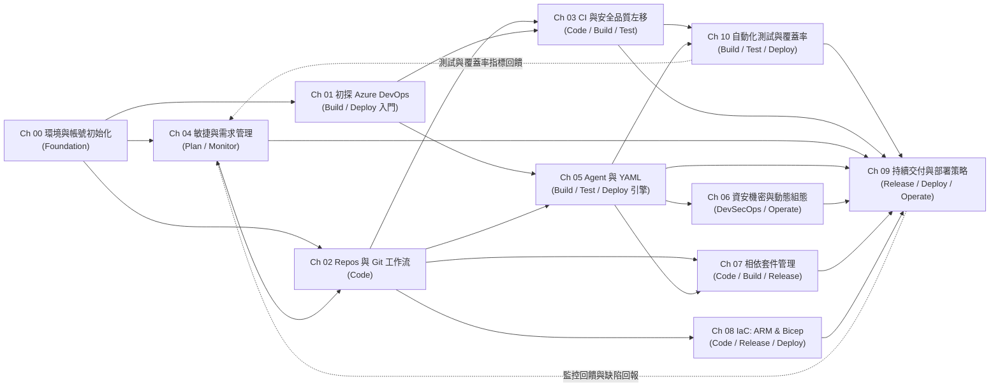

# AZ-400 Azure DevOps 全生命週期知識體系整理

> [!NOTE]
> 本文整理自課程講義 [AZ-400 DevOps 實戰筆記 (HackMD)](https://hackmd.io/@twdeveloper/ByykzFuAGx#CDContinuous-Delivery)，已去除課堂臨時測試帳密與金鑰，重新結構化為 **11 大章節、35 項實作主題**，並標註每一項知識點的 **DevOps 生命週期階段** 與 **上下游相依性**。

---

## 一、DevOps 生命週期階段與章節相依全覽

### 階段歸屬總表

| 章節 | 主題 | 對應 DevOps 階段 | 上游前置相依 | 下游解鎖能力 |
| :--- | :--- | :--- | :--- | :--- |
| **Ch 00** | 課前環境建置與平台初始化 | `Foundation` (前置準備) | 無（系統起點） | 所有 Azure DevOps 與 Azure 雲端實作 |
| **Ch 01** | 認識 Azure DevOps 與 CI/CD 入門 | `Build` → `Deploy` | Ch 00 | Ch 03 進階 CI、Ch 05 YAML、Ch 09 CD |
| **Ch 02** | Azure Repos 與 Git 工作流 | `Code` (連動 `Plan`) | Ch 00、Ch 04 (Work Items) | Ch 03 PR-CI、Ch 05 YAML 版控、Ch 08 IaC 版控 |
| **Ch 03** | 持續整合與品質安全左移 | `Code` → `Build` → `Test` (`DevSecOps`) | Ch 01、Ch 02 | 產出可信 Artifact 供 Ch 09 CD、延伸 Ch 10 自動化測試 |
| **Ch 04** | 敏捷開發、需求追蹤與儀表板 | `Plan` ↔ `Monitor` | Ch 00 | Ch 02 分支關聯 Task、Ch 09 Lab 23 Release Gate |
| **Ch 05** | Build Agent 與 Pipeline-as-Code | `Build` / `Test` / `Deploy` (執行層) | Ch 01、Ch 02 | Ch 09 Multi-Stage YAML、Ch 10 Playwright 管線環境 |
| **Ch 06** | 資安、機密管理與動態組態 | `Plan` → `Code` → `Deploy` → `Operate` | Ch 01/05、Ch 02 | 無密鑰部署、部署與業務發布解耦 (Feature Flags) |
| **Ch 07** | 相依套件管理與私有套件庫 | `Code` → `Build` → `Release` | Ch 01/05、Ch 02 | 元件解耦與版本治理、銜接 SCA 漏洞掃描 |
| **Ch 08** | 基礎設施即程式碼 (ARM / Bicep) | `Code` → `Release` / `Deploy` (`IaC`) | Ch 00、Ch 02 | 自動佈建一致的 Dev/QA/Prod 環境供 Ch 09 部署 |
| **Ch 09** | 持續交付與多元部署策略 (CD) | `Release` → `Deploy` → `Operate` | Ch 03–08、Ch 10 | 零停機交付、治理閘門與監控回饋至 Ch 04 |
| **Ch 10** | 自動化測試與覆蓋率治理 | `Build` → `Test` → `Deploy` | Ch 01、Ch 03、Ch 05 | Playwright E2E UI 回歸與 Cobertura 覆蓋率可視化 |

---

## 二、分章節核心知識點與實作拆解

### Ch 00｜課前環境建置與平台初始化
- **DevOps 階段**：`Foundation`（整體前置基礎）
- **核心知識點**：
  - **帳號與平台**：以 Microsoft Account (MSA) 開通 Azure Portal (`portal.azure.com`) 與 Azure DevOps Organization (`dev.azure.com`)，並透過官方表單申請免費 Parallelism 管線額度。
  - **開發工具鏈**：.NET SDK (3.x–9.x)、VS 2022 Community、VS Code（必裝 `Azure Repos`、`gitignore`、`C#`、`GitHub Copilot`）、Git、Docker Desktop、Postman、Windows Terminal。
  - **實驗環境**：Go Deploy LMS 虛擬實驗室（到期前 15 分鐘內可 Extend）與 Azure DevOps Demo Generator（快速匯入範例專案）。

---

### Ch 01｜認識 Azure DevOps 與 CI/CD 入門
- **DevOps 階段**：`Build` → `Deploy`
- **相依性**：依賴 Ch 00 帳號與專案建置；為後續所有管線實作的最小閉環範例。
- **Lab 1｜Create a Pipeline (CI 入門)**：
  - 建立 Team Project 並匯入遠端 GitHub Repo (`dotNet8BMISample`)。
  - 使用 Classic Editor 建立 Build Pipeline 並開啟 **CI Trigger**，達成程式碼異動即自動建置（新版組織預設可能隱藏 Classic Editor，需於組織設定啟用）。
- **Lab 2｜CI & Deploy to Web App**：
  - 於 Azure Portal 建立 App Service (Web App)，於管線加入 `Azure App Service Deploy` Task。
  - 透過內建變數 `$(build.artifactstagingdirectory)/**/*.zip` 串接建置成品與自動部署。

---

### Ch 02｜Azure Repos 與 Git 工作流
- **DevOps 階段**：`Code`（與 `Plan` 雙向連動）
- **相依性**：依賴 Ch 00 Git 環境與 Ch 04 Work Items；直接支撐 Ch 03 PR-CI 與分支保護。
- **Lab 3-1 & 3-2｜Local Git 與 Azure Repos 同步**：
  - 設定 `git config --global`、初始化 Repo 並**優先建立 `.gitignore`** 排除建置產物 (`bin/`, `obj/`) 與敏感檔案。
  - 掌握 `git remote add origin`、`git push -u origin --all` 與 `git clone` 驗證遠端單一真相來源 (SSOT)。
- **Lab 4｜GitHub Flow & Pull Request**：
  - 完整生命週期：PBI → SBI → Task → **由 Task 建立 Feature Branch** → 修改推送 → 發起 PR 指定 Reviewer → Approve & Merge。
  - 合併後自動連動：程式碼合入 `main`、**Task 自動標記 Done**、Feature Branch 自動刪除。
  - **關鍵設計思考**：為何分支關聯 **Task** 而非 PBI/Bug？因單一 PBI 通常拆解為多個跨職能 Task，綁定 Task 才能維持小批次短命分支，避免單一 PR 合併時誤關尚未完成的 PBI。
- **核心理論**：Martin Fowler《Continuous Integration》與 Dave Farley《Git Flow Is A Bad Idea》——推崇短生命週期分支與高頻整合 (Trunk-Based / GitHub Flow)，避免長壽命分支引發 Merge Hell。

---

### Ch 03｜持續整合與品質安全左移 (CI & DevSecOps)
- **DevOps 階段**：`Code` → `Build` → `Test`（安全與品質左移）
- **相依性**：依賴 Ch 01 Pipeline 與 Ch 02 PR 工作流；為 Ch 09 CD 把關成品品質。
- **Lab 5｜PR-CI 與 Branch Policy**：
  - **雙管線架構**：主線 `CI Pipeline`（啟用 CI Trigger，面向 Prod）；`PR-CI Pipeline`（關閉 CI Trigger，面向 Dev/Test）。
  - 於 `main` 分支設定 **Branch Policy → Build Validation** 綁定 PR-CI，確保 PR 合併前必先通過編譯與測試。
- **Lab 6｜AI 自動化 Code Review (GPT PR Reviewer)**：
  - 在 PR-CI 加入擴充任務串接 Azure OpenAI，需設定 Repo 權限（允許 PR 留言）與 Pipeline 權限（`Allow scripts to access the OAuth token`），自動標出除零錯誤、硬編碼密碼、未用變數等缺陷。
- **Lab 7｜SonarCloud 靜態程式碼掃描 (SAST)**：
  - 整合 SonarCloud 擴充套件，自動分析 Bugs、Vulnerabilities、Code Smells 與技術債，導入 Quality Gate 品質門檻。
- **Lab 8｜WhiteSource Bolt / Mend 套件安全掃描 (SCA)**：
  - 掃描第三方開源相依套件的已知 CVE 漏洞與授權條款 (License) 合規風險。
- **Lab (Git Hook)｜本機 `pre-commit` 防線**：
  - 於 `.git/hooks/pre-commit` 攔截 `git diff-index` 新增內容，偵測到黑名單關鍵字（如 `password|todo|sql`）立即 `exit 1` 阻擋 Commit，將防護左移至開發者本機。

---

### Ch 04｜敏捷開發、需求追蹤與可視化治理
- **DevOps 階段**：`Plan` ↔ `Monitor`
- **相依性**：依賴 Ch 00 建立 Scrum 專案；產出 Work Items 給 Ch 02 分支連動，並產出 Shared Query 給 Ch 09 Lab 23 Release Gate。
- **Lab 9｜Backlogs 與 User Story**：
  - 依據 2020 Scrum Guide 與敏捷宣言建立產品待辦清單 (PBI)、撰寫 User Story、評估 Effort 並規劃 Iteration。
- **Lab 10｜Sprint Planning 與產能管理**：
  - 將每張 PBI 拆解為 3–5 個 Tasks，設定 Remaining Hours 與團隊成員每日 Capacity，運用 **Work Details** 平衡負載並透過 **Sprint Burndown Chart (燃盡圖)** 追蹤進度。
- **Lab 11｜數位儀表板 Dashboard**：
  - 建立 Shared Query 與分組 Query Chart，打造涵蓋 Sprint Burn-Down、CFD（累積流量圖）、Build History、**Cycle Time**（開工到交付）與 **Lead Time**（提案到交付）的可視化戰情室。
- **Lab 12｜Azure DevOps Wiki**：
  - 支援 Markdown、內嵌 **Mermaid** 圖表、`@` 標註成員、`#` 關聯 Work Items；外部工具如 Notion 可透過 Unito 等整合器進行雙向同步。

---

### Ch 05｜建置代理與 Pipeline-as-Code
- **DevOps 階段**：`Build` / `Test` / `Deploy`（跨階段執行引擎）
- **相依性**：依賴 Ch 01 Pipeline 與 Ch 02 Git；是 Ch 09 Lab 25 Multi-Stage YAML 的直接前置能力。
- **Lab 13｜Self-Hosted Linux Agent**：
  - 於 Ubuntu 24.04 自建 Agent 並使用 PAT 註冊；在權限受限環境需建立 **Project-Level Agent Pool**。
  - 故障排除知識：新版 Linux 安裝舊版 .NET SDK 若遇 `libssl`/`libicu` 依賴衝突，可更新套件庫、掛載微軟官方 repo 或升級相容的 .NET SDK 版本。
- **Lab 14｜YAML Pipeline**：
  - 將管線定義寫入 `azure-pipelines.yml` 納入 Git 版控，實現 **Pipeline-as-Code**（支援 Code Review、分支差異化與跨專案重用）。
- **Lab 14-2｜GitHub Actions & Codespaces**：
  - 結合雲端開發環境 Codespaces 與 GitHub 原生 Actions Workflow，理解跨平台 CI/CD 共通架構。

---

### Ch 06｜資安、機密管理與動態組態
- **DevOps 階段**：`Plan (威脅建模)` → `Code` → `Build/Deploy (機密注入)` → `Operate (動態組態/開關)`
- **相依性**：依賴 Ch 01/05 Pipeline 與 Ch 02 應用程式碼；保護 Ch 09 正式部署並讓功能發布與程式碼部署解耦。
- **Microsoft Threat Modeling Tool**：於架構設計階段進行威脅建模，提早識別安全風險。
- **Lab 15｜Azure Key Vault + Variable Groups**：
  - 建立 Key Vault 並配置 IAM / Access Policy 與 Secret，於 ADO 建立連結 Key Vault 的 **Variable Group**，於管線動態注入機密並自動遮蔽日誌輸出。
- **Lab (無金鑰驗證)｜DefaultAzureCredential + RBAC + Managed Identity**：
  - 存取 MS Foundry / Azure OpenAI (LLM API) 時徹底淘汰 API Key：本機開發以 `az login` 認證，部署至 Azure Web App 後啟用 **Managed Identity + RBAC**，程式碼維持一致的 `DefaultAzureCredential`（課程參考影片：`https://www.youtube.com/watch?v=tSa3wTcX2sY`）。
- **Lab 16｜Azure App Configuration**（使用 Go Deploy AZ-400 Lab 11 環境）：
  - 集中化管理 Key/Value 組態（如 `Page:SubTitle`），使設定與程式碼解耦。
- **Lab 17｜Feature Toggle (功能旗標)**：
  - 透過 App Configuration 動態切換 `toggle01`，實現 **Deployment (部署上線) 與 Release (功能開放) 分離**，並可調整 `CacheExpirationInterval` 控制快取更新週期。

---

### Ch 07｜相依套件管理與私有套件庫
- **DevOps 階段**：`Code` → `Build` → `Release`（軟體供應鏈與套件治理）
- **相依性**：依賴 Ch 01/05 CI 建置與 Ch 02 專案版控；向下游應用程式供應版本化套件，並搭配 Ch 03 Lab 8 進行 SCA 安全控管。
- **Lab 18｜NuGet Package 打包與解耦**：
  - 將共用函式庫 `HealthMgr` 封裝為 `.nupkg` 套件，移除 `WebBMI` 的直接專案參考，改為標準 NuGet 相依管理。
- **Lab 19｜自動化發佈與 Azure Artifacts Private Feed**：
  - 設定 `.csproj` 的 `GeneratePackageOnBuild`、`PackageId`、`Version`，以 CI 管線自動將 `**/HealthMgr*.nupkg` 推送至公開 NuGet Gallery 或企業內部 **Private Feed**（並配置 Feed 推送權限）。

---

### Ch 08｜基礎設施即程式碼 (IaC: ARM & Bicep)
- **DevOps 階段**：`Code` (範本版控) → `Release` / `Deploy` (環境自動佈建)
- **相依性**：依賴 Ch 00 Azure CLI 與 Ch 02 Git 版控；為 Ch 09 CD 自動產出一致的 Dev / QA / Prod 目標環境。
- **Lab 20｜ARM Template (JSON)**：
  - 透過宣告式 JSON（`parameters`、`resources`、`outputs`）一次定義並佈建 Dev/QA/Prod Web App 與 `appSettings`，使用 `az group deployment create` 執行，消除人工點擊造成的環境漂移。
- **Lab 20-1｜Azure Bicep**：
  - Azure 原生宣告式 IaC 語言，語法遠比 ARM JSON 簡潔清晰且具強型別提示，底層仍交由 Azure Resource Manager 部署，為現代 Azure IaC 首選。

---

### Ch 09｜持續交付與多元部署策略 (CD: Continuous Delivery)
- **DevOps 階段**：`Release` → `Deploy` → `Operate`（並回饋至 `Monitor` → `Plan`）
- **相依性**：彙整所有前置能力——接收 Ch 03/05 的 CI Artifact、Ch 04 的 Shared Query、Ch 06 的 Key Vault/Feature Flags、Ch 08 的多環境基礎設施與 Ch 10 的自動化測試驗證。
- **Lab 21｜Classic Release Pipeline (多環境遞進)**：串接 CI 成品，建立 `Dev → QA → Prod` 連續自動部署流程。
- **Lab 22｜Pre-Deployment Approvals**：於關鍵環境前插入人工簽核機制，落實發布治理。
- **Lab 23｜Release Gates (自動化閘門)**：串接 Azure Boards Shared Query（並配置查詢權限），設定 `Active Bugs < 5` 等自動化檢核條件取代人工等待。
- **Lab 24｜Blue-Green 藍綠部署 (Deployment Slots)**：先部署至 Staging Slot 驗證，簽核後執行 **Swap Slot** 瞬間切換至 Production，達成零停機部署與秒級回滾。
- **Lab 25｜Multi-Stage YAML Pipeline**：建立 Azure Web App 並在 ADO Project 的 Service Connections 建立 ARM 連線，以單一 YAML 完整定義 Build Stage 與 Deploy Stage（透過 `dependsOn: Build` 與 `environment: 'production'` 銜接 Approvals/Gates），落實完整 CI/CD-as-Code。
- **Lab 26｜Deployment Groups (VM / IIS 叢集)**：於多台 Azure VM 安裝 IIS 與 Agent 註冊腳本，透過 Deployment Group 集中管理並滾動部署傳統主機叢集。

---

### Ch 10｜自動化測試與覆蓋率治理 (Playwright E2E & Code Coverage)
- **DevOps 階段**：`Build` → `Test` → `Deploy`（並回饋品質指標至 `Monitor` → `Plan`）
- **相依性**：依賴 Ch 01 Pipeline 基礎、Ch 03 CI 品質防線與 Ch 05 YAML / Agent 執行環境；為 Ch 09 CD 上線前後提供可重複的 E2E UI 驗證與覆蓋率把關。
- **Lab 27-1｜Playwright 本機錄製與自動化 UI 測試**：
  - 全域安裝 `dotnet tool install --global Microsoft.Playwright.CLI`，建立 MSTest 專案（`dotnet new mstest`）、安裝 `Microsoft.Playwright` 套件、執行 `dotnet build` 與 `playwright install` 下載瀏覽器核心。
  - 使用 **`playwright codegen`** 互動式錄製目標網站（如 `https://td-testplan.azurewebsites.net/`）自動產出 C# UI 測試腳本（參考 `isdaviddong/PlaywrightAutoUITest`），並以 `dotnet test` 執行驗證。
- **Lab 27-2｜Playwright Auto UI Test 整合至 Azure Pipelines**：
  - 匯入 `PlaywrightAutoUITest.git`，於 `windows-latest` Agent 依序設定 `UseDotNet@2`（SDK `5.0.408`）、`DotNetCoreCLI@2`（`restore` 與 `build`）。
  - **關鍵必設步驟**：新增兩道 `PowerShell@2` Task，分別執行 `dotnet tool install --global Microsoft.Playwright.CLI` 與 `playwright install`（於全新雲端 Build Agent 安裝執行期瀏覽器），最後以 `DotNetCoreCLI@2`（`test` 指向 `**/PlaywrightAutoUITest.csproj`）完成自動化 E2E UI 測試。
- **Lab 28｜Unit Test Code Coverage (單元測試程式碼覆蓋率)**：
  - **本機報表**：Clone `dotNet8BMISample.git`，安裝 `dotnet tool install -g dotnet-reportgenerator-globaltool`，執行 `dotnet test --collect:"XPlat Code Coverage"` 產出 `coverage.cobertura.xml`，再透過 `reportgenerator -reports:"<path>\coverage.cobertura.xml" -targetdir:"coveragereport" -reporttypes:Html` 產生互動式 HTML 報表。
  - **Pipeline 整合**：在基礎 .NET Web App Pipeline 的 `dotnet test` 任務加入參數 `--collect:"XPlat Code Coverage"`，並新增 **Publish Code Coverage Results v1.0**（工具選 `cobertura`、Summary file 設為 `$(Agent.TempDirectory)/**/coverage.cobertura.xml`），建置後即可於 ADO Build Summary 檢視視覺化覆蓋率報表。

